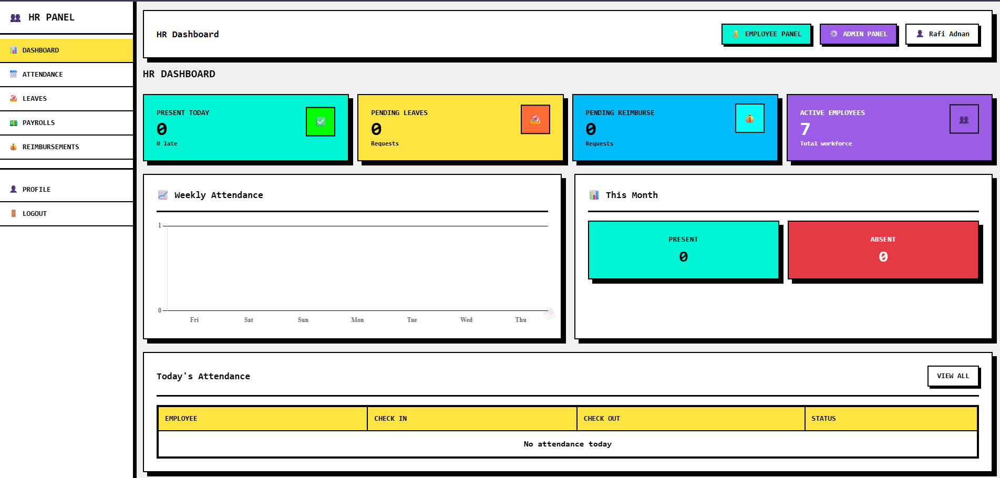
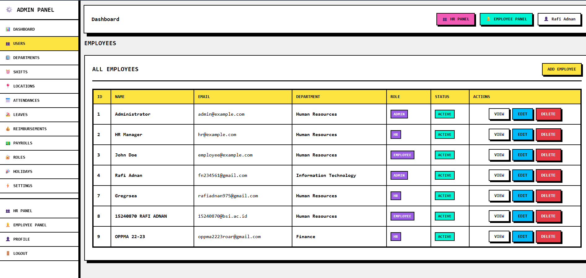
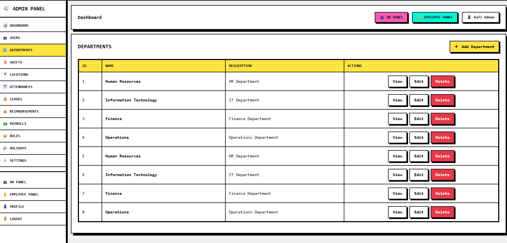
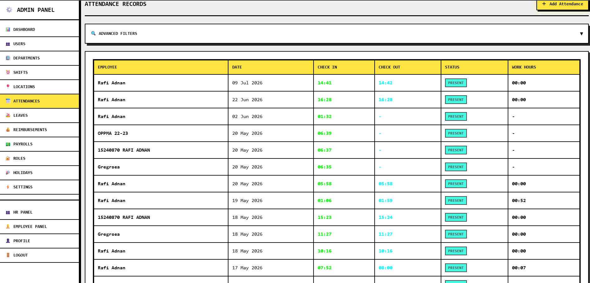
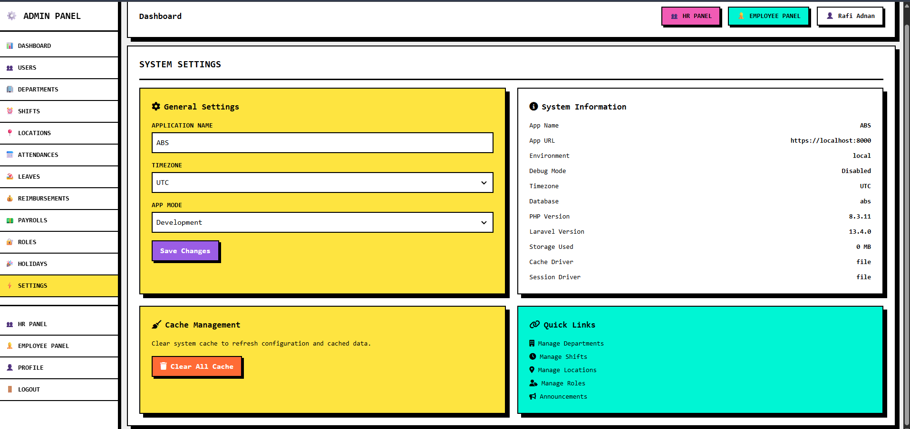
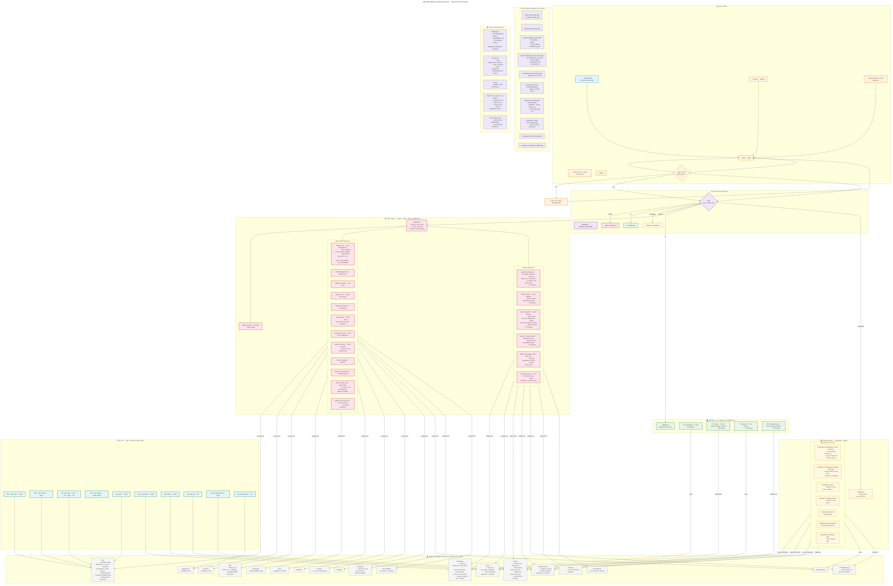

# ABS - Attendance & Employee Management System

<p align="center">
  
  
  
  
  
</p>

## Overview

**ABS (Attendance & Employee Management System)** is a comprehensive web application for managing employee attendance, leaves, payroll, and reimbursements. Built with Laravel 13, Tailwind CSS, Alpine.js, and Leaflet for GPS location tracking.

## Tech Stack

| Layer | Technology |
|-------|-----------|
| Backend | Laravel 13.x (PHP 8.3) |
| Frontend | Tailwind CSS 3.x, Alpine.js 3.x |
| Database | MySQL 8.0+ |
| Maps | Leaflet.js (OpenStreetMap) |
| Auth | Laravel Breeze + Fortify |
| Icons | Font Awesome 7.0.1 |

## Architecture

```
abs/
├── app/
│   ├── Http/Controllers/
│   │   ├── Admin/           # Admin panel controllers
│   │   ├── HR/              # HR panel controllers
│   │   ├── Employee/        # Employee panel controllers
│   │   ├── Api/V1/          # API controllers (Sanctum auth)
│   │   └── Auth/            # Authentication controllers
│   ├── Models/              # Eloquent models
│   ├── Services/            # Business logic services
│   ├── Middleware/          # Custom middleware
│   └── Providers/           # Service providers
├── resources/views/
│   ├── admin/               # Admin panel views (Blade)
│   ├── hr/                  # HR panel views
│   ├── employee/            # Employee panel views
│   └── layouts/             # Shared layouts
├── routes/
│   ├── web.php              # Main routes
│   ├── api.php              # API routes (Sanctum)
│   └── auth.php             # Authentication routes
├── database/
│   ├── migrations/          # 31 migration files
│   └── seeders/             # Database seeders
├── tests/                   # PHPUnit tests (95 tests)
└── public/
    ├── assets/              # CSS, JS, images
    └── build/               # Compiled assets
```

**Architecture pattern:** MVC with Blade templates, resource controllers, and service-based authorization (role-based access via middleware).

## Features

### Employee Panel
- **Smart Attendance** - Check-in/check-out with GPS location tracking via Leaflet maps
- **Leave Management** - Request leaves with date range and reason
- **Reimbursements** - Submit expense claims with approval workflow
- **Payroll View** - View salary slips and payment history
- **Announcements** - Stay updated with company announcements
- **Email Notifications** - Queued emails for leave, reimbursement, and payroll status changes

### HR Panel
- **Attendance Monitoring** - View all employee attendance records
- **Leave Approval** - Approve or reject leave requests
- **Reimbursement Approval** - Process employee expense claims
- **Payroll Management** - View and manage payroll records

### Admin Panel
- **User Management** - Create, edit, and manage employee accounts
- **Department Management** - Organize employees by department
- **Role & Permission System** - Granular access control (Admin, HR, Employee)
- **Shift Management** - Configure work schedules and shifts
- **Location Management** - Manage office locations for attendance
- **Holiday Calendar** - Set company holidays
- **Salary Rules** - Configure salary calculation rules
- **Overtime Rules** - Define overtime policies
- **Payroll Confirmation Workflow** - Payroll must be confirmed before it can be marked as paid
- **Audit Trail** - Immutable log of payroll and approval actions with actor, IP, and changed values
- **System Settings** - Configure application settings
- **Dashboard Analytics** - Key metrics and reports

### REST API (Sanctum Authentication)
- **Attendance API** - Employee check-in/check-out with GPS validation, duplicate prevention, overnight shift support, ownership enforcement
- **Payroll Calculation API** - Calculate payroll with attendance, overtime, reimbursements, late penalties; bulk calculate; generate payrolls from calculations
- **Role-based Access** - `admin`, `hr`, `employee` middleware; employees only access own records
- **Active Account Check** - Rejects inactive accounts on all API routes
- **Payroll Lock** - Paid payrolls cannot be modified or deleted
- **Token Login** - `POST /api/login` returns a Sanctum bearer token; `POST /api/logout` revokes it

```bash
# Login and get a token
curl -X POST http://localhost:8000/api/login \
  -H "Content-Type: application/json" \
  -H "Accept: application/json" \
  -d '{"email":"admin@example.com","password":"password"}'

# Use the token
curl http://localhost:8000/api/user \
  -H "Authorization: Bearer <token>" \
  -H "Accept: application/json"
```

## Setup Instructions

### Prerequisites
- PHP 8.3+
- Composer 2.x
- Node.js 18+
- MySQL 8.0+

### Installation

```bash
git clone https://github.com/Rafiadnan0666/absen-laravel.git
cd absen-laravel

# Install dependencies
composer install
npm install

# Configure environment
cp .env.example .env
php artisan key:generate

# Database - edit .env with your MySQL credentials
# DB_CONNECTION=mysql
# DB_HOST=127.0.0.1
# DB_PORT=3306
# DB_DATABASE=abs_laravel
# DB_USERNAME=root
# DB_PASSWORD=

# Run migrations
# Default data (roles, permissions, departments, job titles, shifts,
# office location, salary rules, overtime rules) is seeded automatically.
php artisan migrate

# Optional: re-run the idempotent seeders at any time
php artisan db:seed

# Full reset (drops all tables, migrates and seeds)
php artisan migrate:fresh --seed

# Build frontend
npm run build

# Start server
php artisan serve

# In a second terminal: process queued emails
php artisan queue:work
```

Visit `http://localhost:8000`

## Screenshots

<table>
<tr>
<td align="center" width="50%">
<b>Admin Dashboard</b><br>

</td>
<td align="center" width="50%">
<b>HR Panel</b><br>

</td>
</tr>
<tr>
<td align="center" width="50%">
<b>Attendance Tracking</b><br>

</td>
<td align="center" width="50%">
<b>Departments Management</b><br>

</td>
</tr>
<tr>
<td align="center" width="50%">
<b>Employee Panel</b><br>

</td>
<td align="center" width="50%">
<b>Attendance Records</b><br>

</td>
</tr>
<tr>
<td align="center" width="50%">
<b>Profile Modal</b><br>

</td>
<td align="center" width="50%">
<b>Settings</b><br>

</td>
</tr>
</table>

### System Architecture

<p align="center">

</p>

## Default Roles

| Role | Access Level |
|------|-------------|
| Admin | Full system access |
| HR | HR management and approvals |
| Employee | Standard user access |

## Default Accounts (local/development only)

`DevUserSeeder` only runs when `APP_ENV=local` or `APP_ENV=development`. All demo accounts use the password `password`.

| Email | Role |
|-------|------|
| `admin@example.com` | Admin |
| `hr@example.com` | HR |
| `employee@example.com` | Employee |

> These accounts are skipped in `testing` and `production`. Create real users through the admin panel or change the passwords before deploying.

## Default Seeded Data

`php artisan migrate` (and `php artisan db:seed`) seeds the reference data the app needs to function:

| Data | Defaults |
|------|----------|
| Roles | admin, hr, employee |
| Permissions | 34 permissions mapped to each role |
| Departments | Human Resources, Information Technology, Finance, Operations |
| Job Titles | Software Engineer, HR Manager, Finance Analyst, Operations Staff, Admin |
| Shifts | Regular (08:00-17:00, 15 min tolerance, default) |
| Locations | Kantor Pusat (-6.2088, 106.8456, 100 m radius) |
| Salary Rules | monthly, daily, hourly (overtime rate + late/absent/early-leave penalties) |
| Overtime Rules | 1 h → 1.5x, 2 h → 2.0x |

All seeders are idempotent, so running them again will not create duplicates.

## Testing

Run the full test suite:

```bash
php artisan test
```

Run specific test file:

```bash
php artisan test tests/Feature/LeaveTest.php
```

Run with coverage (requires Xdebug):

```bash
php artisan test --coverage
```

Current suite: **95 tests / 251 assertions**

| Test file | Scenarios |
|-----------|-----------|
| `LeaveTest` | 14 — leave request, validation, HR approval/rejection, employee/HR/admin access control, audit + queued email |
| `ReimbursementTest` | 13 — submission, validation, HR approval/rejection, ownership and role access, audit + queued email |
| `PayrollTest` | 13 — payroll creation, confirmation workflow, paid guard, rejection, audit trail, queued email, role access, paid payroll lock |
| `AttendanceTest` | 10 — check-in, GPS geofence (inside/outside radius), validation, role access |
| `ApiAuthorizationTest` | 14 — API auth, ownership, duplicate prevention, overnight shifts, payroll calc, inactive users |
| `Auth/*`, `ProfileTest` | 24 — login, registration, password reset/update, profile management |
| `ShiftTest`, `UserDefaultShiftTest`, `PayrollBulkTest`, `ExampleTest` | 7 — shifts, bulk payroll, smoke tests |

## Authorization Matrix

Role middleware redirects unauthorized users to `/dashboard`; record-level ownership checks return `403`.

| Area | Guest | Employee | HR | Admin |
|------|-------|----------|----|-------|
| `/employee/*` | → login | ✅ own records | → dashboard | → dashboard |
| `/hr/*` | → login | → dashboard | ✅ | ✅ |
| `/admin/*` | → login | → dashboard | → dashboard | ✅ |
| Other employee's leave/reimbursement | → login | 403 | ✅ (HR view) | ✅ |
| `/api/employee/*` | 401 | ✅ own records | 403 | 403 |
| `/api/admin/*` | 401 | 403 | 403 | ✅ |
| `/api/admin/payroll-calculations/*` | 401 | 403 | 403 | ✅ |

## Known Limitations

- **Business logic in controllers** - Approval and payroll workflows live in service classes; remaining CRUD is still controller-based
- **No 2FA** - No two-factor authentication implemented
- **Neo-brutalism design** - Heavy CSS shadows may not render consistently on all devices
- **Queue worker required** - Emails are queued in the database and need `php artisan queue:work` running in production

## CI/CD

GitHub Actions runs on every push to `main` and `interface/neurobrutalism`, on pull requests to `main`, and daily at 06:00 UTC:
- Install dependencies (`composer install`, `npm ci`)
- Build frontend assets (`npm run build`)
- Setup MySQL database
- Run migrations
- Run PHPUnit tests
- Report PASS / FAIL

See `.github/workflows/test.yml` for the pipeline configuration.

## License

MIT License.

## Support

For issues and feature requests, please create an issue on GitHub.