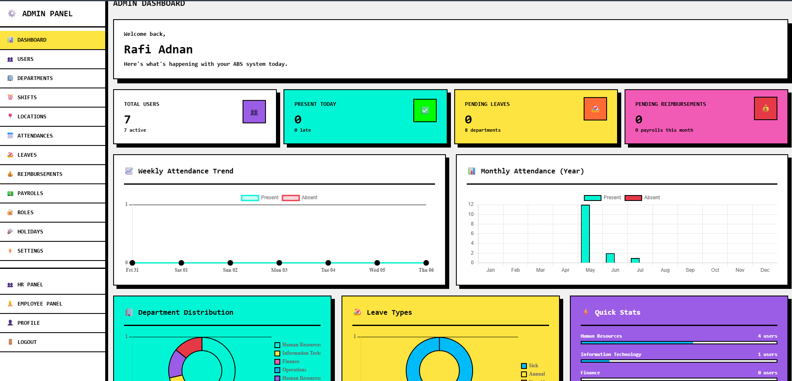
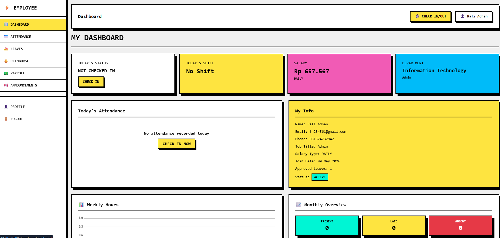
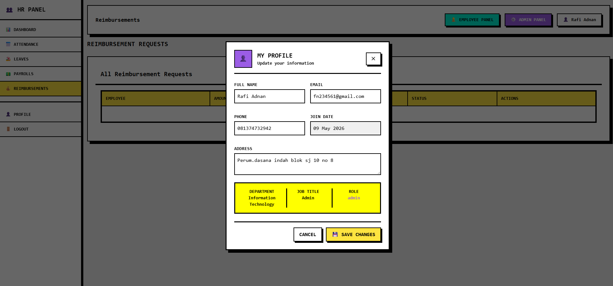

# ABS - Attendance & Employee Management System

<p align="center">
  
  
  
  
  
</p>

## Overview

**ABS (Attendance & Employee Management System)** is a comprehensive web application for managing employee attendance, leaves, payroll, and reimbursements. Built with Laravel 12, Tailwind CSS, Alpine.js, and Leaflet for GPS location tracking, with a Sanctum-authenticated REST API for mobile clients.

## Table of Contents

- [Features](#features)
- [Screenshots](#screenshots)
- [Quick Start](#quick-start)
- [Setup Workflow](#setup-workflow)
- [Admin Panel Setup Guide](#admin-panel-setup-guide)
- [Technology Stack](#technology-stack)
- [Database Schema (ERD)](#database-schema-erd)
- [Installation](#installation)
- [Default Roles](#default-roles)
- [Default Accounts](#default-accounts-localdevelopment-only)
- [Default Seeded Data](#default-seeded-data)
- [Project Structure](#project-structure)
- [Security Features](#security-features)
- [Testing](#testing)
- [Authorization Matrix](#authorization-matrix)
- [Production Deployment](#production-deployment)
- [Known Limitations](#known-limitations)
- [CI/CD](#cicd)
- [License](#license)

## Features

### Employee Panel
- **Smart Attendance** - Check-in/check-out with GPS location tracking via Leaflet maps
- **Leave Management** - Request leaves with date range and reason
- **Reimbursements** - Submit expense claims with approval workflow
- **Payroll View** - View salary slips and payment history
- **Announcements** - Stay updated with company announcements
- **Email Notifications** - Queued emails for leave, reimbursement, and payroll status changes

### HR Panel
- **Attendance Monitoring** - View all employee attendance records
- **Leave Approval** - Approve or reject leave requests
- **Reimbursement Approval** - Process employee expense claims
- **Payroll Management** - View and manage payroll records

### Admin Panel
- **User Management** - Create, edit, and manage employee accounts
- **Department Management** - Organize employees by department
- **Role & Permission System** - Granular access control (Admin, HR, Employee)
- **Shift Management** - Configure work schedules and shifts
- **Location Management** - Manage office locations with GPS coordinates (Leaflet map picker)
- **Holiday Calendar** - Set company holidays
- **Salary Rules** - Configure salary calculation rules
- **Overtime Rules** - Define overtime policies
- **Payroll Confirmation Workflow** - Payroll must be confirmed before it can be marked as paid
- **Audit Trail** - Immutable log of payroll and approval actions with actor, IP, and changed values
- **System Settings** - Configure application settings
- **Dashboard Analytics** - Key metrics and reports

### REST API (Sanctum Authentication)
- **Attendance API** - Employee check-in/check-out with GPS validation, duplicate prevention, overnight shift support, ownership enforcement
- **Payroll Calculation API** - Calculate payroll with attendance, overtime, reimbursements, late penalties; bulk calculate; generate payrolls from calculations
- **Role-based Access** - `admin`, `hr`, `employee` middleware; employees only access their own records
- **Active Account Check** - Rejects inactive accounts on all API routes
- **Payroll Lock** - Paid payrolls cannot be modified or deleted
- **Token Login** - `POST /api/login` returns a Sanctum bearer token; `POST /api/logout` revokes it

## Screenshots

<table>
<tr>
<td align="center" width="50%">
<b>Admin Dashboard</b><br>

</td>
<td align="center" width="50%">
<b>HR Panel</b><br>

</td>
</tr>
<tr>
<td align="center" width="50%">
<b>Attendance Tracking</b><br>

</td>
<td align="center" width="50%">
<b>Departments Management</b><br>

</td>
</tr>
<tr>
<td align="center" width="50%">
<b>Employee Panel</b><br>

</td>
<td align="center" width="50%">
<b>Attendance Records</b><br>

</td>
</tr>
<tr>
<td align="center" width="50%">
<b>Profile Modal</b><br>

</td>
<td align="center" width="50%">
<b>Settings</b><br>

</td>
</tr>
</table>

## Quick Start

```bash
# Clone and setup
git clone https://github.com/Rafiadnan0666/absen-laravel.git
cd absen-laravel

# Install dependencies
composer install
npm install

# Configure environment
cp .env.example .env
# Edit .env with your database credentials

# Setup (default data is seeded automatically by the migration)
php artisan key:generate
php artisan migrate

# Optional: re-run the idempotent seeders at any time
php artisan db:seed

# Build assets
npm run build

# Run server
php artisan serve

# In a second terminal: process queued emails
php artisan queue:work

# Visit http://localhost:8000
# Login: admin@example.com / password
```

## Setup Workflow

### Initial System Configuration (Admin Only)

Default departments, job titles, shifts, locations, salary rules, and overtime rules are seeded automatically. The steps below are only needed when you want to customize them.

#### 1. **Create Departments** (Admin → Departments)
   - Create organizational departments (e.g., IT, HR, Finance)
   - Employees will be assigned to these departments

#### 2. **Create Job Titles** (Admin → Job Titles)
   - Define job positions (e.g., Developer, Manager, Analyst)
   - Used for employee profile and organizational structure

#### 3. **Create Shifts** (Admin → Shifts)
   - Define work schedules (e.g., Morning 08:00-17:00, Night 20:00-05:00)
   - Overnight shifts (end time earlier than start time) are supported
   - Example:
     - Morning Shift: 08:00 - 17:00 (15 min tolerance)
     - Night Shift: 20:00 - 05:00

#### 4. **Create Office Locations** (Admin → Locations)
   - Add office/check-in locations with GPS coordinates
   - Use the interactive Leaflet map picker to select coordinates or search an address
   - Set the radius (geo-fence area in meters)
   - Example: "Head Office Jakarta" at -6.2088, 106.8456 (Radius: 100m)
   - Employees must check-in within this radius

#### 5. **Create Salary Rules** (Admin → Salary Rules)
   - Define pay types, overtime rate, and penalties
   - Required fields:
     - **Tipe Gaji**: hourly, daily, or monthly
     - **Rate Lembur**: Overtime rate per hour (e.g., Rp 50,000/hour)
     - **Penalti Telat Per Menit**: Late penalty per minute (e.g., Rp 1,000/minute)
     - **Penalti Tidak Hadir**: Absent penalty (e.g., Rp 150,000)
     - **Gaji Per Hari / Gaji Per Jam**: Used for daily/hourly pay types
     - **Penalti Alfa / Penalti Pulang Cepat**: Absence and early-leave penalties

#### 6. **Create Overtime Rules** (Admin → Overtime Rules)
   - Define overtime eligibility and calculation
   - Required fields:
     - **Minimal Jam**: Minimum overtime hours to trigger the rule (e.g., 1.0)
     - **Multiplier**: Overtime pay multiplier (e.g., 1.5 for 1.5x pay)
   - Example: "1+ hour of overtime = 1.5x the hourly overtime rate"

#### 7. **Create Holidays** (Admin → Holidays)
   - Add national/company holidays
   - These are excluded from attendance calculations

#### 8. **Create Employees** (Admin → Users)
   - Add employee accounts with required fields:
     - **Nama Lengkap**: Full name
     - **Email**: Unique login email
     - **Job Title**: Select from created job titles
     - **Department**: Select from created departments
     - **Tipe Gaji**: salary type (hourly, daily, monthly)
     - **Jumlah Gaji**: Base salary amount
     - **Tanggal Masuk**: Join date
     - **No HP / Alamat**: Contact details
   - Assign the **Employee** role
   - A default shift is assigned automatically when one is configured

#### 9. **Create HR Users** (Admin → Users, same as step 8)
   - Create HR staff accounts
   - Assign the **HR** role
   - HR can approve leaves and reimbursements

#### 10. **Assign Shifts to Employees** (Admin → User Shifts)
   - Link employees to their work shifts
   - Supports rotation schedules

### Employee Operations

#### Attendance Workflow
1. **Check-in** (Employee Panel)
   - Click "Check In"
   - The browser requests GPS location
   - The system verifies the location is within the office radius
   - Check-in time and location are recorded
   - Duplicate check-ins for the same day are rejected

2. **Check-out** (Employee Panel)
   - Same GPS verification as check-in
   - The system calculates:
     - Work hours (check-out time - check-in time)
     - Lateness minutes (if after shift start + tolerance)
     - Early leave minutes (if before shift end)
     - Overtime hours (if after shift end), including overnight shifts

#### Leave Request Workflow
1. **Request Leave** (Employee → Leaves)
   - Fill the form: leave type, start date, end date, reason
   - Status: Pending (awaits HR approval)

2. **HR Approves/Rejects** (HR → Leaves)
   - Approve: the leave is counted in payroll calculations
   - Reject: the employee retains their quota

#### Reimbursement Request Workflow
1. **Submit Reimbursement** (Employee → Reimbursements)
   - Fill the form: category, amount in Rupiah, description
   - Status: Pending

2. **HR Approves/Rejects** (HR → Reimbursements)
   - Approved reimbursements are included in the next payroll calculation

### Payroll Processing

#### Prerequisites
- Salary rules configured
- Employees have a salary type and amount set
- Attendance records exist for the period
- Overtime rules configured

#### Payroll Calculation Steps
1. **System Auto-Calculates:**
   - **Gaji Pokok** (Base): fixed salary, or daily/hourly rate × attendance
   - **Total Lembur** (Overtime): overtime hours × overtime rate × applicable multiplier
   - **Total Potongan** (Deductions): late minutes, absent days, and early-leave minutes
   - **Bonus**: added manually by HR/Admin
   - **Reimbursements**: approved claims in the period
   - **Total Gaji** (Net): Pokok + Lembur + Bonus + Reimbursements - Potongan

2. **Create Payroll** (Admin → Payrolls)
   - Define the period (start date - end date)
   - Duplicate payroll periods for the same employee are rejected
   - Status: Pending

3. **Confirm Payroll** (Admin → Payrolls)
   - Review the calculation, then confirm or reject with a reason

4. **Mark as Paid** (Admin → Payrolls)
   - Only confirmed payrolls can be marked as paid
   - Paid payrolls are locked from further edits or deletion

5. **View Payroll** (Employee → Payroll)
   - Employees see only their own payslip and component breakdown

## Admin Panel Setup Guide

### Dashboard
- **Real-time metrics**: Total users, departments, attendances, leaves, payrolls
- **Charts**: Weekly/monthly attendance trends, department distribution
- **Recent records**: Latest attendance, leaves, reimbursements

### Users Management
- **List/Filter**: Search by name, department, status (active/inactive)
- **Create**: Add new employees with full details
- **Edit**: Update employee information
- **Delete**: Deactivate accounts (soft delete recommended)

### Departments
- **List**: View all departments
- **Create**: Add a new department with name and description
- **Edit**: Update department details

### Shifts
- **List**: View all configured shifts
- **Create**: Add a work shift with name, start time, end time, and late tolerance
- **Default flag**: Exactly one shift can be the default for new users

### Locations
- **List**: View all office locations
- **Create**: Add a location with name, interactive map coordinates, and radius
- **Edit**: Modify location and radius using the map

### Attendance
- **View**: All attendance records
- **Filter**: By date, department, status, employee
- **Edit**: Correct attendance errors
- **Export**: Download attendance report as CSV

### Leaves
- **View**: All leave requests
- **Filter**: By date, type, status
- **Approve/Reject**: With optional rejection reason

### Payrolls
- **View**: All payroll periods
- **Create**: New payroll period (start-end dates)
- **Calculate**: System auto-calculates based on attendance, overtime, and reimbursements
- **Confirm / Reject / Mark Paid**: Explicit workflow with audit trail
- **Details**: View payroll component breakdown

### Salary Rules
- **Configure**: Pay types (hourly, daily, monthly)
- **Set**: Overtime rate, late/absent/early-leave penalties

### Overtime Rules
- **Set**: Minimum hours for overtime eligibility
- **Set**: Overtime pay multiplier

### Holidays
- **Add**: National/company holidays
- **Exclude**: These days don't count as absent

## Technology Stack

| Layer | Technology |
|-------|-----------|
| Backend | Laravel 12.x (PHP 8.2+) |
| Frontend | Tailwind CSS 3.x, Alpine.js 3.x |
| Maps | Leaflet.js (OpenStreetMap) with Nominatim Geocoder |
| Database | MySQL 8.0+ |
| Authentication | Laravel Breeze + Sanctum (web session + API tokens) |
| Icons | Font Awesome 7.0.1 |
| Build | Vite 5.x |
| Charts | Chart.js 4.x |

## Database Schema (ERD)

See [ERD.md](ERD.md) for the complete Entity Relationship Diagram with Mermaid visualization.

### Key Tables
- **users** - Core user table with profile, employment, and auth info
- **departments** - Organizational departments
- **job_titles** - Job positions/titles
- **roles** / **permissions** - Role-based access control
- **attendances** - Daily attendance records
- **attendance_logs** - Detailed check-in/out logs with GPS
- **leaves** - Leave requests and approvals
- **payrolls** / **payroll_details** - Payroll periods, totals, and component breakdown
- **reimbursements** - Expense claims
- **locations** - Office locations for GPS check-in
- **shifts** / **user_shifts** - Work shift definitions and assignments
- **salary_rules** - Salary, overtime, and penalty rules
- **overtime_rules** - Overtime thresholds and multipliers
- **holidays** - Company holidays
- **audit_logs** - Immutable audit trail for sensitive actions

## Installation

### Prerequisites
- PHP 8.3+
- Composer 2.x
- Node.js 18+
- MySQL 8.0+

### Steps

1. **Clone the repository**
   ```bash
   git clone https://github.com/Rafiadnan0666/absen-laravel.git
   cd absen-laravel
   ```

2. **Install PHP dependencies**
   ```bash
   composer install
   ```

3. **Install NPM dependencies**
   ```bash
   npm install
   ```

4. **Configure environment**
   ```bash
   cp .env.example .env
   ```
   
   Edit `.env` with your database credentials:
   ```
   DB_CONNECTION=mysql
   DB_HOST=127.0.0.1
   DB_PORT=3306
   DB_DATABASE=abs
   DB_USERNAME=root
   DB_PASSWORD=your_password
   ```

5. **Generate application key**
   ```bash
   php artisan key:generate
   ```

6. **Run migrations**
   ```bash
   # Default data (roles, permissions, departments, job titles, shifts,
   # office location, salary rules, overtime rules) is seeded automatically.
   php artisan migrate
   ```

7. **Optional: re-run the idempotent seeders**
   ```bash
   php artisan db:seed
   ```

   For a full reset:
   ```bash
   php artisan migrate:fresh --seed
   ```

8. **Build frontend assets**
   ```bash
   npm run build
   ```

9. **Start the development server**
   ```bash
   php artisan serve
   ```

10. **Start the queue worker** (for queued emails)
    ```bash
    php artisan queue:work
    ```

11. **Access the application**
    - Visit: `http://localhost:8000`
    - Admin Login: `admin@example.com` / `password`
    - HR Login: `hr@example.com` / `password`
    - Employee Login: `employee@example.com` / `password`

## Default Roles

| Role | Access Level | Can Do |
|------|-------------|--------|
| Admin | Full system access | Manage all config, users, attendance, payroll, reports |
| HR | HR operations | Approve leaves, reimbursements, view payroll, manage attendance |
| Employee | Standard user | Check-in/out, request leave, submit reimbursement, view payroll |

## Default Accounts (local/development only)

`DevUserSeeder` only runs when `APP_ENV=local` or `APP_ENV=development`. All demo accounts use the password `password`.

| Email | Role |
|-------|------|
| `admin@example.com` | Admin |
| `hr@example.com` | HR |
| `employee@example.com` | Employee |

> These accounts are skipped in `testing` and `production`. Create real users through the admin panel or change the passwords before deploying.

## Default Seeded Data

`php artisan migrate` (and `php artisan db:seed`) seeds the reference data the app needs to function:

| Data | Defaults |
|------|----------|
| Roles | admin, hr, employee |
| Permissions | 34 permissions mapped to each role |
| Departments | Human Resources, Information Technology, Finance, Operations |
| Job Titles | Software Engineer, HR Manager, Finance Analyst, Operations Staff, Admin |
| Shifts | Regular (08:00-17:00, 15 min tolerance, default) |
| Locations | Kantor Pusat (-6.2088, 106.8456, 100 m radius) |
| Salary Rules | monthly, daily, hourly (overtime rate + late/absent/early-leave penalties) |
| Overtime Rules | 1 h → 1.5x, 2 h → 2.0x |

All seeders are idempotent, so running them again will not create duplicates.

## Project Structure

```
abs/
├── app/
│   ├── Http/Controllers/
│   │   ├── Admin/           # Admin panel controllers
│   │   ├── HR/              # HR panel controllers
│   │   ├── Employee/        # Employee panel controllers
│   │   ├── Api/V1/          # REST API controllers (Sanctum)
│   │   └── Auth/            # Authentication controllers
│   ├── Http/Middleware/     # Role and active-account middleware
│   ├── Models/              # Eloquent models
│   ├── Services/            # Payroll and business logic services
│   └── Providers/           # Service providers
├── resources/views/
│   ├── admin/               # Admin panel views
│   ├── hr/                  # HR panel views
│   ├── employee/            # Employee panel views
│   ├── components/          # Reusable Blade components
│   └── layouts/             # Shared layouts
├── routes/
│   ├── web.php              # Main routes
│   ├── api.php              # API routes (Sanctum)
│   └── auth.php             # Authentication routes
├── database/
│   ├── migrations/          # 39 migration files
│   └── seeders/             # 12 idempotent seeders
├── lang/                    # English and Indonesian translations
├── tests/                   # PHPUnit tests (17 test files, 95 passing)
└── public/
    ├── assets/              # CSS, JS, images
    └── build/               # Compiled assets (Vite)
```

**Pattern:** MVC with Blade templates, resource controllers, service classes for payroll/calculations, and middleware-based authorization.

## Security Features

- Role-based access control (RBAC) for web and API
- Password hashing with bcrypt
- CSRF protection
- XSS protection via Blade escaping
- SQL injection prevention via Eloquent ORM
- Account status management (active/inactive) enforced on API routes
- Session-based web auth plus Sanctum API tokens
- API login rate limiting (`throttle:5,1`)
- Record-level ownership checks (employees can only access their own records)
- Location-based attendance verification
- Duplicate check-in and duplicate payroll period prevention
- Paid payroll locking
- Audit logging for sensitive operations

### API Authentication

```bash
# Login and get a token
curl -X POST http://localhost:8000/api/login \
  -H "Content-Type: application/json" \
  -H "Accept: application/json" \
  -d '{"email":"admin@example.com","password":"password"}'

# Use the token
curl http://localhost:8000/api/user \
  -H "Authorization: Bearer <token>" \
  -H "Accept: application/json"

# Logout (revokes the current token)
curl -X POST http://localhost:8000/api/logout \
  -H "Authorization: Bearer <token>" \
  -H "Accept: application/json"
```

## Testing

Run the full test suite:

```bash
php artisan test
```

Run a specific test file:

```bash
php artisan test tests/Feature/LeaveTest.php
```

Run with coverage (requires Xdebug):

```bash
php artisan test --coverage
```

Current suite: **95 tests / 251 assertions**

| Test file | Scenarios |
|-----------|-----------|
| `LeaveTest` | 14 - leave request, validation, HR approval/rejection, employee/HR/admin access control, audit + queued email |
| `ReimbursementTest` | 13 - submission, validation, HR approval/rejection, ownership and role access, audit + queued email |
| `PayrollTest` | 13 - payroll creation, confirmation workflow, paid guard, rejection, audit trail, queued email, role access, paid payroll lock |
| `AttendanceTest` | 10 - check-in, GPS geofence (inside/outside radius), validation, role access |
| `ApiAuthorizationTest` | 14 - API auth, ownership, duplicate prevention, overnight shifts, payroll calculation, inactive users |
| `Auth/*`, `ProfileTest` | 24 - login, registration, password reset/update, profile management |
| `ShiftTest`, `UserDefaultShiftTest`, `PayrollBulkTest`, `ExampleTest` | 7 - shifts, bulk payroll, smoke tests |

## Authorization Matrix

Role middleware redirects unauthorized users to `/dashboard`; record-level ownership checks return `403`.

| Area | Guest | Employee | HR | Admin |
|------|-------|----------|----|-------|
| `/employee/*` | → login | ✅ own records | → dashboard | → dashboard |
| `/hr/*` | → login | → dashboard | ✅ | ✅ |
| `/admin/*` | → login | → dashboard | → dashboard | ✅ |
| Other employee's leave/reimbursement | → login | 403 | ✅ (HR view) | ✅ |
| `/api/employee/*` | 401 | ✅ own records | 403 | 403 |
| `/api/admin/*` | 401 | 403 | 403 | ✅ |
| `/api/admin/payrolls/*` | 401 | 403 | 403 | ✅ |

## Production Deployment

1. **Configure environment**
   ```bash
   # In .env file
   APP_ENV=production
   APP_DEBUG=false
   DB_PASSWORD=strong_password_here
   ```

2. **Optimize Laravel**
   ```bash
   php artisan config:cache
   php artisan route:cache
   php artisan view:cache
   php artisan optimize
   ```

3. **Configure web server**

   For Apache, ensure `.htaccess` is configured properly. For Nginx, configure your server block to point to the `public` directory.

4. **Set proper permissions**
   ```bash
   chmod -R 775 storage bootstrap/cache
   chown -R www-data:www-data storage bootstrap/cache
   ```

5. **Setup HTTPS**
   ```bash
   # Using Let's Encrypt with Certbot
   sudo certbot certonly --webroot -w /var/www/html -d yourdomain.com
   ```

6. **Run the queue worker** under a process manager (Supervisor/systemd):
   ```bash
   php artisan queue:work --tries=3
   ```

## Known Limitations

| Limitation | Impact | Workaround |
|------------|--------|------------|
| **Business logic in controllers** | Some CRUD logic still lives in controllers | Extract remaining workflows into services |
| **GPS tolerance** | Check-in radius is fixed per location | Adjust `radius_meter` per location |
| **Neo-brutalism design** | Heavy CSS shadows may not render consistently | Test on target devices/browsers |
| **No 2FA** | No two-factor authentication | Add 2FA via Fortify |
| **Queue worker required** | Emails are queued and need a worker | Run `php artisan queue:work` in production |

## CI/CD

GitHub Actions runs on every push to `main` and `interface/neurobrutalism`, on pull requests to `main`, and daily at 06:00 UTC:
- Install dependencies (`composer install`, `npm ci`)
- Build frontend assets (`npm run build`)
- Setup MySQL database
- Run migrations
- Run PHPUnit tests
- Report PASS / FAIL

See `.github/workflows/test.yml` for the pipeline configuration.

## License

MIT License.

## Support

For issues and feature requests, please create an issue on GitHub.
